# Financing with Doug

**A money program that runs on your own computer, shows you where you stand,
and — this is the unusual part — tells you where you are heading.**

*Named after a machine-learning model that was, by every available metric, bad
at its job. Doug has since improved considerably.*

---

## 1. What is it?

Doug reads the transaction files you can download from your bank's website and
turns them into a picture of your money: what you own, what you owe, what comes
in, what goes out, and where it all went.

Plenty of programs do that much. Here is what most of them don't do.

**Doug looks forward.** Instead of only reporting last month, it takes your
actual history — your salary, your rent, your groceries, your car payment — and
plays the next few years forward hundreds of times over. Not one guess. Hundreds
of versions of your future, some lucky, some not. What you get is a shaded fan
on a chart:

> *"By next summer you will most likely have about $8,000 in the bank — but
> depending on how the year goes, anywhere between $3,000 and $14,000."*

That range is the honest answer, and it is the thing a single confident number
on a screen can never tell you.

**Doug tells you when the money runs out — and how badly.** There is a
difference between being five dollars short on a Thursday and genuinely running
out of money, and Doug says which one it is, on what date, and usually what
caused it. When it is just two bills landing in the wrong order, it will offer
to move one past payday and show you what that fixes.

**Doug grades your spending, and explains the grade.** You get a score out of
ten and a letter grade, measured against a well-known budgeting guideline (50%
of income on needs, 30% on wants, 20% saved). It deliberately separates *how you
spend* from *how much you earn*, so somebody on a modest income who is careful
with it still scores well. If money is tight, Doug will tell you whether that is
your spending or simply your fixed costs — and it will not tell you the
comfortable version if it isn't true.

**Doug lets you play with your own future.** Drag a slider to spend 20% less on
eating out. Add $200 a month to the car loan. Ask what happens if the roof
needs $6,000 in March. The chart redraws immediately, so *"can I actually afford
this?"* becomes something you can look at rather than something you worry about.

**Doug checks its own homework.** This is the part to trust it for. The Progress
page rewinds to a date months ago, rebuilds the forecast using *only* what was
known back then, and lays it over what actually happened. If Doug has been
wrong, that page is where you find out.

### Your information never leaves your computer

There is no account to create, no password, no cloud, no sync, and nothing is
ever uploaded anywhere. Everything sits in one file on your own machine. The
program only touches the internet for one thing: asking whether a newer version
of itself exists.

That also means nobody can recover it for you. If the numbers start to matter,
copy that one file somewhere safe now and then — it lives in a folder called
`.ledgerline` inside your user folder.

---

## 2. Installing it

Windows only for now, and it takes about a minute.

**Step 1 — Download it.** Go to the
[**latest release**](https://github.com/harpe119/Financing-With-Doug/releases/latest)
page and, under **Assets**, click the file named
`FinancingWithDoug-<version>-Setup.exe` — the version is a number like `1.18.2`.
It will land in your Downloads folder.

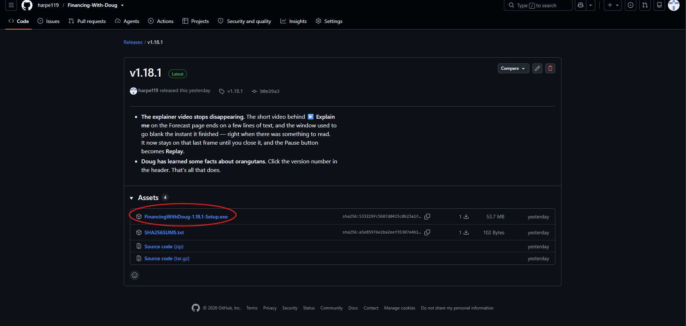

**Step 2 — Run it.** Double-click the file you just downloaded.

**Step 3 — Get past the blue warning.** Windows will probably show a blue box
saying **"Windows protected your PC"**. This is not a virus warning. It appears
for any program that hasn't paid for a certificate, which costs money every year
and isn't worth it for something handed around a family. Click **More info**,
then **Run anyway**. You will only see this once.

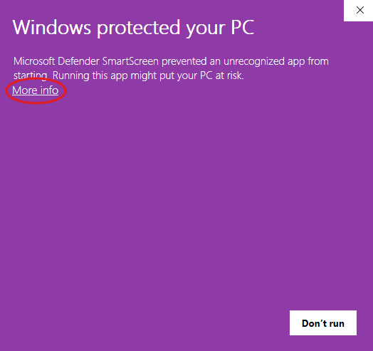

**Step 4 — Next, Next, Finish.** It will offer to put a shortcut on your
desktop; say yes. It never asks for an administrator password, because it
installs just for you rather than for the whole computer.

That's it. Open it from the desktop shortcut or the Start menu.

### It keeps itself up to date

Once a day, Doug quietly asks whether a newer version exists. If there isn't
one, it says nothing at all. If there is, it shows you what changed and offers a
**Download and install** button that does the whole thing for you.

You can also check whenever you like: there is a **Check for updates** button
along the top of the window, next to *File*, *Edit* and *Help*. It always
answers, including *"you're up to date"*.

<!-- PICTURE: the top of the window with the "Check for updates" menu button.

-->

**Updating never touches your information.** Your accounts, transactions, goals
and settings are stored separately from the program itself, so an update — or
even uninstalling and reinstalling — picks up exactly where you left off. The
uninstaller says so before it runs.

### Try it with fake money first

Before you type in a single real number, use **File → Load demo dataset**. It
opens one of five made-up households — a comfortable one, a struggling one, a
thriving one, someone turning things around, and one going badly wrong.

Nothing you do in a demo can touch your own data. Each one lives in a completely
separate file, an orange banner across the top reminds you where you are, and
**File → Return to my own data** puts you straight back.

This is far and away the fastest way to see what every page is *for*. Open
**Thriving** and **Spiralling** one after the other and the whole program
explains itself.

---

## 3. Getting your bank's information in

Doug does not connect to your bank. You download a file, and you give it to
Doug. It's a couple of clicks once you know where they hide it.

### Step 1 — Tell Doug about your accounts

Go to the **Accounts** page and click **Add account** for each one: checking,
savings, credit cards, loans, investments.

For each, you type the balance **as it is right now** and the date that was
true. Doug works your history backwards from that number, so getting the date
right matters more than you'd think.

- **Credit cards and loans** — type what you *owe* as a positive number.
- **Loans** also want the interest rate, the monthly payment, and which day of
  the month it comes out.
- **Investments** want a guess at the yearly return (7% is a common assumption
  for a broad stock fund) and how much you add each month. Don't agonise — they
  are assumptions, and you can change them later.

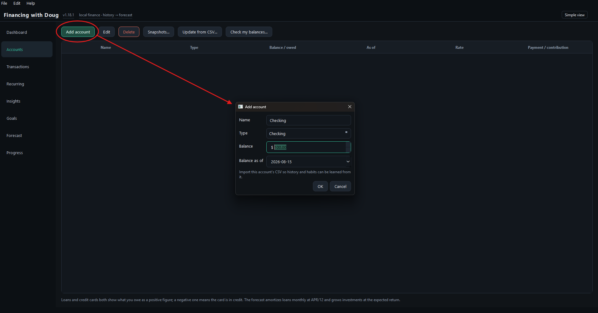

### Step 2 — Download a CSV from your bank

Log into your bank's website — not the phone app, which usually can't do this —
and look for a button near your transaction list saying something like:

> **Download** · **Export** · **Download transactions** · **Statements &
> activity**

Choose **CSV** as the format. It may be described as "spreadsheet" or "Excel
format" — CSV is the one you want, **not PDF**. A PDF is a picture of your
statement; a CSV is the actual numbers.

**Ask for as long a period as it will give you.** Twelve to eighteen months is
ideal. Under three months and Doug won't have enough to find your regular bills
or say anything useful about your habits.

Save it in your Downloads folder. You don't need to open it, and you shouldn't
try to tidy it up — Doug expects it exactly as the bank wrote it.

<!-- PICTURE: a bank website with the Download/Export button circled.
     Retake this one: the current file is a real account and the black boxes
     miss a Verizon payment and two running balances. Any bank's site will do
     as an example — cover every amount and balance, not just the merchants.

-->

### Step 3 — Give the file to Doug

**File → Import CSV…**, pick which account it belongs to, and choose the file.

Doug reads the file and works out for itself which column is the date, which is
the description, and which is the amount — banks all do this differently and it
handles the common ones. It then shows you the rows it found so you can check
before anything is saved.

**Glance at three things before you press Import:**

1. Does the **Date** column show real dates?
2. Does the **Description** column show shop names?
3. Do the things you *spent* appear as **negative** numbers? If they're the
   wrong way round — which is normal for credit cards — change the **Amounts**
   setting to the flipped option.

Then press **Import**.

**You cannot break anything here.** Importing the same file twice adds nothing,
because Doug fingerprints every row. If you get the setup wrong, fix it and
import again.

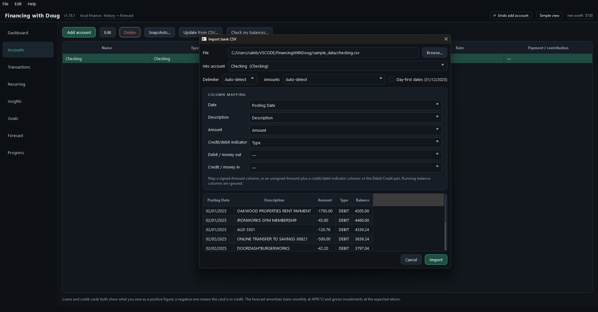

### Step 4 — Tidy up the categories

Doug guesses what each transaction was — groceries, petrol, dining — from the
shop name. It gets most of them and misses some.

Go to **Transactions → Review uncategorized…**. Crucially, this lists
**shops, not transactions**, biggest first. Labelling "SAFEWAY" once fixes every
Safeway charge you have ever made *and every one you make in future*. Twenty
minutes here is worth more than an hour of editing rows one at a time.

Two things worth knowing:

- **It remembers.** Every correction you make is applied to next month's import
  automatically.
- **It generalises.** Teach it `BLUE BOTTLE COFFEE` and it will also catch
  `SQ *BLUE BOTTLE 0042` — while keeping `BLUE CROSS` well clear of it.

Categories drive the score, the charts and the forecast, so this is the step
that pays for itself.

<!-- PICTURE: Transactions → Review uncategorized, with merchants listed.
     Retake this one against a demo dataset. The current file blacks out the
     merchant names but leaves the summary line readable ($52,609 total, 332
     transactions), which is still real information about a real household.

-->

### And then, once a month

1. Download a fresh file from your bank.
2. **Accounts → Update from CSV…** — no setup the second time, it remembers how
   your bank's file is laid out, and only genuinely new rows are added.
3. Correct any balances that have drifted.

Five minutes. That's the whole ongoing commitment.

> **Got something wrong?** Press **Ctrl+Z**. Every single change can be taken
> back, and the Undo button tells you what it's about to reverse — *Undo import
> CSV*, *Undo delete account* — so you never have to guess. One press undoes one
> *thing you did*, so undoing an import removes everything that import brought
> in, together.

---

## 4. The eight pages, and how to read them

The list down the left-hand side is the whole program. In one line each:

| Page | The question it answers |
|---|---|
| **Dashboard** | Where do I stand right now? |
| **Accounts** | What do I own and owe? |
| **Transactions** | What did I actually spend it on? |
| **Recurring** | What comes out every month without me thinking about it? |
| **Insights** | Where does the money go, and is that sensible? |
| **Goals** | What am I saving for, and in what order? |
| **Forecast** | Where is this heading? |
| **Progress** | Is it working — and was Doug right last time? |

There is a **Simple view / Everything** switch at the top of the window. Simple
hides the more technical panels. Nothing is lost by leaving it on; flip it any
time.

### Dashboard — where you stand today

The home screen. Your net worth, your cash, your debt, and three charts: how
your net worth has moved over time, what came in against what went out each
month, and where the last 90 days actually went.

**How to read it:** the top number is everything you own minus everything you
owe. The line chart's *slope* matters more than its height — a line drifting
upwards is the thing you want, whatever it starts at.

Doug also puts notices here when it spots something, like a subscription that
has quietly gone up in price.

<!-- PICTURE: the Dashboard page.
     Retake this one against File → Load demo dataset — the current file is a
     real ledger with nothing redacted. Check the amber DEMO DATA banner is
     visible before you grab it; every other page shot has it.

-->

### Accounts — what you own and owe

Where you set everything up and keep it current. Also home to **Check my
balances**, which compares the balance you typed against what your transactions
add up to and tells you if they've drifted apart.

**How to read it:** if Doug says an account doesn't add up, it usually means
your imported history doesn't reach back far enough — not that anything is
wrong. You can note it and move on.

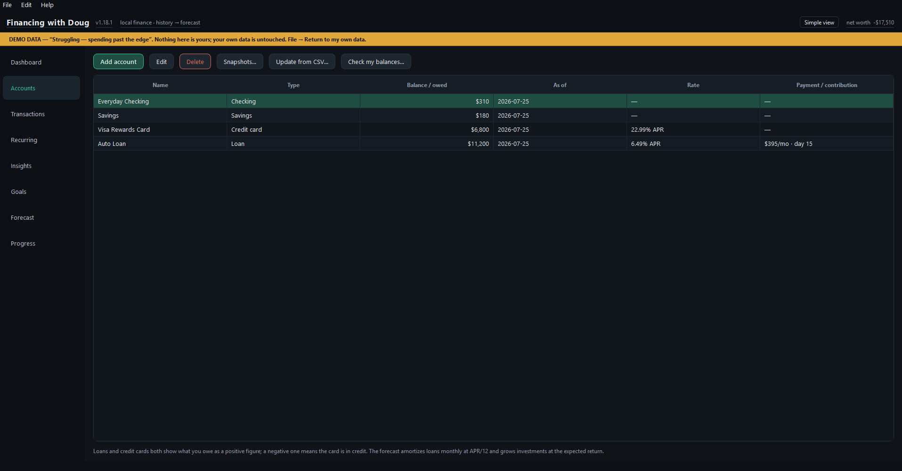

### Transactions — the ledger itself

Every row Doug knows about. Search it, filter it by date, and correct any
category from the dropdown on the row.

**How to read it:** you mostly come here to fix a label. Anything you change is
remembered forever and applied to future imports.

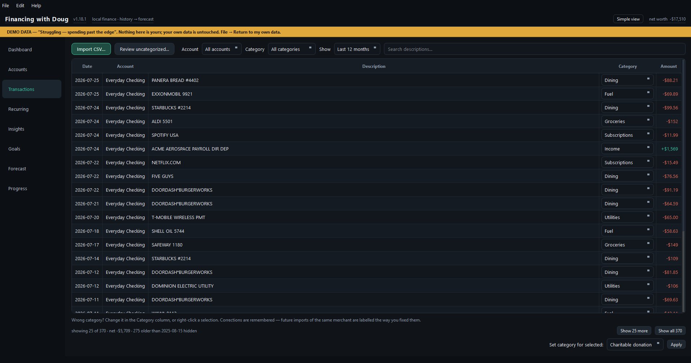

### Recurring — what repeats

Doug finds your regular payments on its own: rent, salary, subscriptions, the
car payment. Each one shows how often it happens, the usual amount, when it's
next expected, and how confident Doug is that it's really a pattern.

**How to read it:** have a look through once and untick anything that's stopped,
like a cancelled subscription. That's most of what this page needs from you, and
it makes the forecast noticeably better.

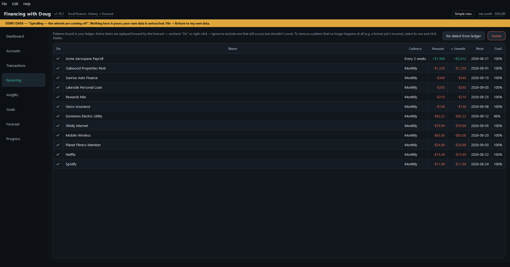

### Insights — the grade

Your score out of ten, your letter grade, and where the money went.

**How to read it:** the grade weighs two separate things — how you spend (wants
measured against necessities) and whether you're living within your income. That
split is deliberate, so being careful on a small income still grades well. The
sentence underneath the grade is the part to actually read; it says which of
those two things is driving it.

Anything Doug couldn't categorise is left *out* of the score rather than assumed
frivolous. If a lot is uncategorised the grade is marked *provisional* — that's
a nudge to go back and label a few more shops.

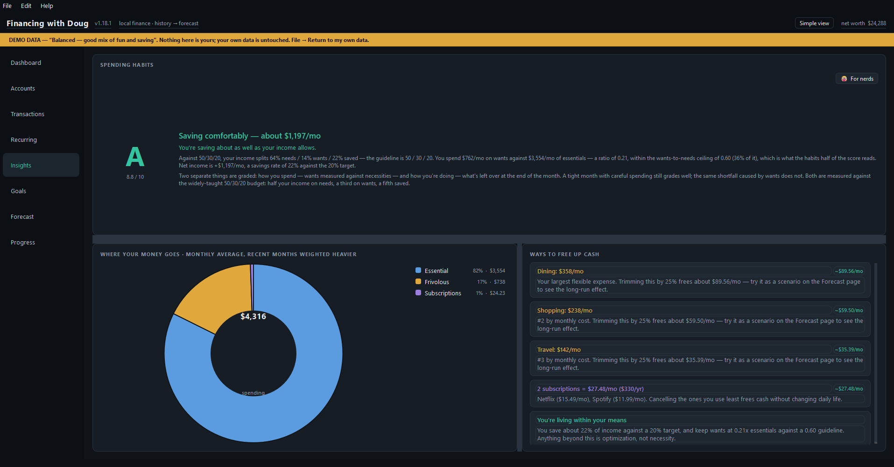

### Goals — what you're working towards

Your debts and your savings goals in one ordered list, because they compete for
the same spare money. Put them in the order you care about, and choose whether
spare cash goes all to the top one or gets split.

**How to read it:** the point of this page is the hand-off. When a loan is paid
off, its whole monthly payment rolls into whatever is next, and the page dates
it for you — *"Mar 2028 — Car loan paid off → $412/mo rolls into Emergency
fund."* That's how the last debt turns into the first savings goal instead of
quietly vanishing into everyday spending.

**Getting there sooner** answers a different question: name a date you want
something by, and Doug tells you what you'd have to give up to hit it, by name
and in dollars. If it isn't reachable, it says so rather than suggesting you cut
into the rent.

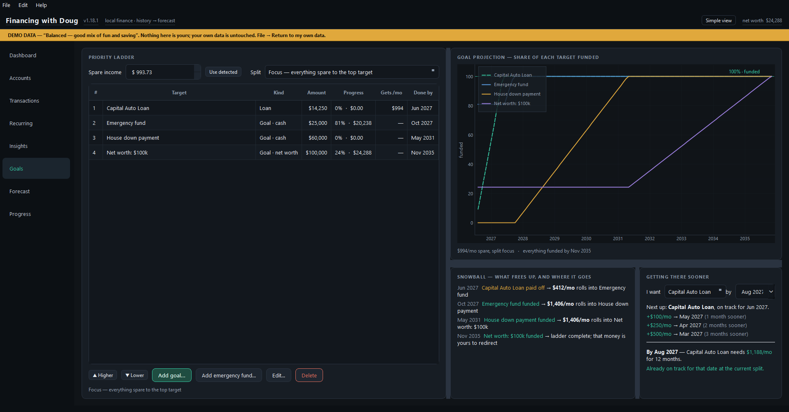

### Forecast — where this is heading

The main event, and the page most worth spending time on.

**How to read it:** the shading *is* the answer, not the line through the middle.

- The **solid line** is the middle outcome — half of the futures Doug simulated
  land above it, half below.
- The **darker band** is where the middle half of futures landed.
- The **lighter band** is where 8 out of 10 landed.

A wide band means the future genuinely is uncertain. Narrowing it by ignoring it
would not make it any less so. There's a short video behind the ▶ **Explain me**
button that covers exactly this, and at just over a minute it's the best minute
you can spend in this program.

Underneath the chart, one plain sentence tells you whether the money actually
runs out — everything from *"cash holds up"* through *"a tight patch, then it
clears"* to *"high risk of running out of cash"*. Only that last one means what
it says. When it's a timing problem rather than a real shortage, a **What's
causing this?** button appears and names the bills involved.

Then have a play. Drag the category sliders, add extra loan payments, add a
one-off event for a new car or a bonus, and watch the fan move.

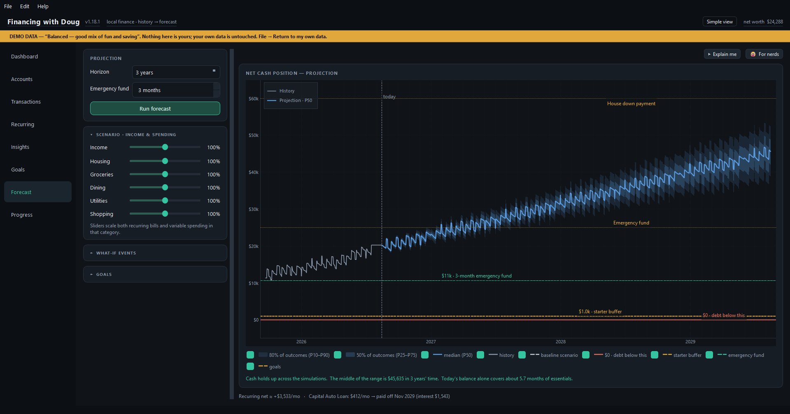

### Progress — is it working?

Two questions, both worth asking.

**Was Doug right?** It draws an old forecast against what actually happened. If
the forecast is any good, reality should land inside the band roughly 8 times
out of 10 — and this page tells you the real figure.

**Did anything actually change?** Doug tests whether your spending genuinely
shifted or whether it's just normal month-to-month noise, and says how sure it
is. It never reports "no change" when the truth is "not enough data yet" — it
tells you which.

That second one exists for a specific feeling: *"it doesn't feel like I'm
getting anywhere."* Sometimes the numbers disagree with the feeling, and it's
worth knowing which of the two is right.

> Just installed and this page is empty? **Progress → Reconstruct history…**
> builds the missing history from data you already have, so it works today
> rather than in six months.

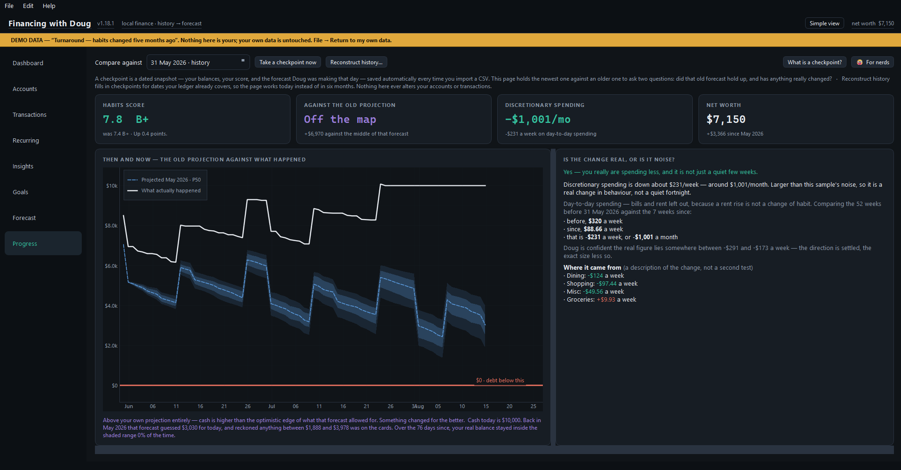

---

## Limits

Doug is a good instrument, not an oracle. Some things it doesn't do:

- It doesn't model credit-card interest, so a card balance sits still unless
  your imported transactions move it.
- Regular bills are assumed to stay the same size — no inflation, no scheduled
  rent increases.
- The forecast assumes you carry on roughly as you have been. It will spot one
  clear change in your habits and adapt to it, but a slow drift gets averaged.
- The grade is a sensible rule of thumb, not a validated financial index, and
  it's only as good as your categories. It ignores things a human would weigh,
  like how much debt you're carrying.

**And the important one:** this produces statistical estimates from your own
history. It is a modelling tool, not an all-knowing financial wizard.

---

## Where to go next

- **[Getting started](docs/getting-started.md)** — the same journey as above but
  step by step and in more detail. Also inside the app: **Help → Getting
  started**, or just press `F1`.
- **[What's new](docs/whats-new.md)** — what changed in each version, in plain
  sentences.
- **[Methodology](docs/methodology.md)** — every formula, and why it's that one.
  Warning: this one has actual mathematics in it.
- **[Working on the code](docs/development.md)** — running from source, the
  tests, and building an installer.
- **[Changelog](CHANGELOG.md)** — the full engineering record.

The version you're running is shown in the app header and under **Help → About
Doug**. Click the version number for something that is not useful.
