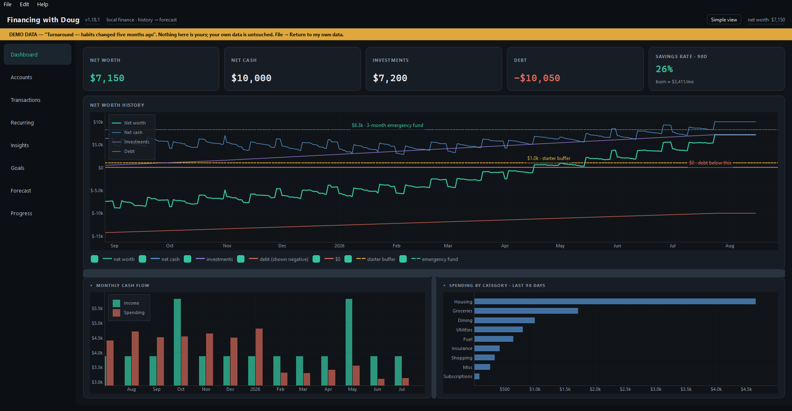

# Financing with Doug

Doug is a desktop app for reviewing your accounts, spending, and financial
forecast. You import CSV files from your bank; Doug does not connect to your
bank or move money.



## What it does

- Tracks balances, debts, investments, and net worth.
- Finds recurring bills and income in your transaction history.
- Lists upcoming bills and paydays on a calendar.
- Shows spending by category and compares it with a budgeting benchmark.
- Projects cash and net worth, with a range of modeled outcomes.
- Lets you test changes to income, spending, debt payments, and investing.

The forecast is an estimate based on your history and assumptions. It is not
a promise or financial advice. Unexpected expenses, missing transactions,
and changes in income can put actual results outside the displayed range.

## Install

Download the Windows installer from the
[latest release](https://github.com/harpe119/Financing-With-Doug/releases/latest).
Choose the asset named `FinancingWithDoug-<version>-Setup.exe`, run it, and
follow the installer.

Windows may show a SmartScreen warning because the installer is unsigned.
Only continue if you trust the download and have checked where it came from.
The app's **Check for updates** command checks for newer releases.

## Set up

1. Open **Accounts → Add account**. Enter each balance and the date it was
   recorded. Enter credit-card and loan amounts owed as positive numbers.
2. Download transaction history from your bank in CSV format.
3. Use **File → Import CSV…**, select the account, and check the preview.
   Spending should be negative and income positive.
4. Review categories in **Transactions** and patterns in
   **Bills & payday → Recurring patterns**.
5. Open **Forecast** to see the projection and test changes.

Currency fields use fixed-decimal entry: typing `1234` gives **$12.34**;
typing `123400` gives **$1,234.00**. Backspace removes the last digit.
You can also paste a formatted amount such as `$1,234.56`.
Percentages use normal decimal entry.

The [getting-started guide](docs/getting-started.md) has the full walkthrough.
It is also available under **Help → Getting started**.

## Navigation

| Section | Contents |
|---|---|
| Dashboard | Overview and Spending |
| Accounts | Balances and account settings |
| Transactions | Search, categories, and imported entries |
| Bills & payday | Calendar and Recurring patterns |
| Goals | Savings targets and priorities |
| Forecast | Projection and Progress |

The calendar lists scheduled items, not all future spending. Account balances
include only items with a payment account supported by the imported ledger.
Everyday spending, future transfers, and unassigned items are excluded.
Check the **Unassigned items** filter before relying on an account total.

On the Forecast tab, **Watch explanation** opens the original video in your
computer's video player. **How this works** opens the written explanation.
Use **Reset scenario** to undo temporary forecast adjustments.
The **Data quality** panel flags records to verify before interpreting the
projection. **Review data** explains each flag and links to the relevant page.
These checks identify possible gaps; they do not measure forecast accuracy.

## Try a demo

**File → Load demo dataset** opens a separate database with fictional data.
Choose Balanced, Struggling, Thriving, Turnaround, or Spiralling.
**File → Return to my own data** returns to your database.

## Your data and backups

Financial data is stored locally in `.ledgerline/ledgerline.db` inside your
user folder. The status bar shows the database currently open.
The updater contacts GitHub to check and download releases; financial data
is not sent with those requests.

Use **File → Back up data…** to save a complete copy of the open database.
A backup made in a demo contains the demo. Backups include database settings,
but not the separate view preference or in-memory undo history.

To restore, close Doug, keep a copy of the current database, and replace it
with the backup at the path shown in the status bar.

## Run from source

Requires Python 3.10 or newer.

```bash
python -m venv .venv
# Linux/macOS:
source .venv/bin/activate
# Windows PowerShell:
# .venv\Scripts\Activate.ps1
pip install -r requirements.txt
python run.py
```

To use another database:

```bash
python run.py --db "path/to/ledger.db"
```

To run the checks:

```bash
python tests/test_core.py
python tests/test_usability.py
```

[Methodology](docs/methodology.md) explains the calculations and assumptions.
[Development](docs/development.md) covers the source and packaging.
[Releasing](docs/releasing.md) covers Windows builds.
